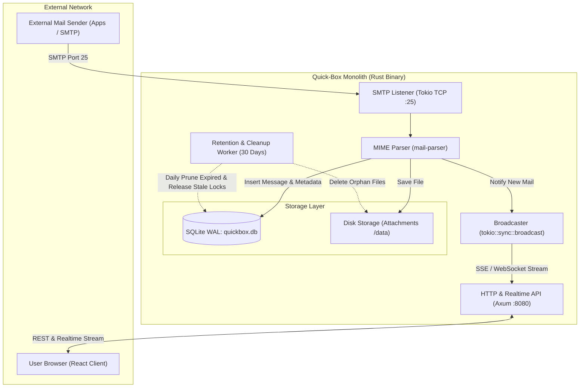

# Technical Design Document: Quick-Box (Monolithic Temporary Email Service)

> **Status:** Draft for Review  
> **Date:** 2026-11-04  
> **Author:** Antigravity & Project Owner  
> **Target Scope:** MVP (Phase 1–8 Roadmap)  
> **Primary Goal:** Open-source developer-focused temporary inbox service with password lock, 30-day retention, and instant OTP extraction in a single-process Rust monolith + React frontend.

---

## 1. Intent and The Why

Developers frequently need disposable email inboxes during local and staging development to test authentication flows (signups, password resets, verification emails, magic links, OTP codes). Existing services like Yopmail or Mailinator have distinct limitations:
1. **Zero Privacy:** Any public inbox can be read by anyone guessing or knowing the address.
2. **Short Retention:** Emails expire within a few days (e.g., 8 days on Yopmail), causing broken regression testing.
3. **Proprietary & Closed:** Cannot be customized, self-hosted, or integrated seamlessly in private staging environments.
4. **No Automated Developer Tooling:** Manual searching through long HTML bodies to find a 6-digit OTP code or verification button.

**Quick-Box** solves these challenges by providing a friction-free, open-source, single-binary monolithic temporary email server. It enables instant inbox access, optional password locking to preserve private test scenarios, 30-day retention, automatic OTP/magic-link detection, and a safe, sandboxed reading environment.

---

## 2. Goals, Non-Goals, and Anti-Goals

### Goals
- **Instant Usability:** Anyone can access any `@domain` inbox immediately without registering an account.
- **Privacy on Demand:** Inboxes can be locked with an optional password, restricting viewing to holders of that password.
- **Extended Retention:** Keep test emails accessible for 30 days by default (configurable).
- **Auto-Release Policy:** Inactive locked inboxes automatically unlock and return to public status after 30 days of inactivity, preventing permanent name-squatting of common names like `test` or `admin`.
- **Developer Experience:** Auto-detection of 4–8 digit OTP codes and verification links with one-click copy.
- **Single-Process Monolith:** Minimal operational complexity—one lightweight Rust binary + embedded/bundled React UI running in a single Docker container consuming < 50MB RAM.

### Non-Goals (MVP)
- Outbound email sending or replying (SMTP relay integration is planned post-MVP).
- Public programmatic CI/CD REST API keys and webhook triggers (deferred to v2).
- Native mobile applications.
- Long-term personal email storage or replacing personal email providers.

### Anti-Goals
- **Security Vulnerabilities:** Rendering raw HTML emails that can trigger Cross-Site Scripting (XSS), script execution, or unauthenticated tracking pixels without user consent.
- **Permanent Name Squatting:** Allowing malicious or inactive users to lock critical inbox names forever.
- **Operational Bloat:** Requiring external message brokers (Redis, RabbitMQ), separate database clusters, or complex microservices.

---

## 3. Constraints

- **Language & Runtime:** Rust (Tokio asynchronous runtime) for the backend; React (Vite + TypeScript + Tailwind CSS) for the frontend.
- **Architecture:** Monolith (Single binary serving both SMTP listener and HTTP/WebSocket API).
- **Database:** SQLite with Write-Ahead Logging (WAL) enabled via `sqlx`.
- **Resource Footprint:** Capable of running on a minimal VPS (512MB–1GB RAM, 1 vCPU).
- **Networking:** Inbound port 25 for SMTP, HTTP/WS port 8080 (or 80/443 via reverse proxy).

---

## 4. Approaches Considered & Trade-Offs

### Approach 1: Asynchronous Single-Process Monolith (Tokio + Axum + Embedded SMTP + SQLite) — **SELECTED**
- **Architecture:** A single Rust application executing three concurrent Tokio tasks:
  1. Asynchronous SMTP listener on port 25 parsing incoming MIME emails.
  2. Axum web framework serving REST endpoints and WebSocket/SSE streams.
  3. Background cleanup task purging expired emails (>30 days) and releasing stale locks.
  Static React assets compiled and optionally embedded or served directly.
- **Trade-offs:** 
  - *Pros:* Minimum memory footprint (~20–40 MB), zero external runtime dependencies, trivial Docker deployment (`docker compose up -d`), excellent idiomatic Rust learning path (async channels, actors/tasks, Arc/Mutex patterns).
  - *Cons:* Restarting the application causes a momentary interruption to the SMTP socket on port 25.
- **Selection Decision:** Selected by the project owner as the ideal balance between learning Rust/React, ease of self-hosting, and operational simplicity.

### Approach 2: Decoupled Multi-Service with Message Queue
- **Architecture:** Separate SMTP receiver daemon writing to Redis/RabbitMQ, separate API daemon reading from queue.
- **Trade-offs:** High fault tolerance, but excessive complexity and operational overhead for MVP. Rejected.

### Approach 3: Postfix/MTA External Daemon + Webhook
- **Architecture:** Standard Linux Postfix daemon piping incoming mail into a Rust webhook.
- **Trade-offs:** Relies on legacy system configs, difficult to run and test locally on Windows/macOS. Rejected.

---

## 5. System Architecture & Component Design



---

## 6. Data Specifications & Models

### 6.1 Database Schema (SQLite)

```sql
-- Inboxes table (Single-domain scope: name is the lowercase local-part e.g. "budi-test")
CREATE TABLE IF NOT EXISTS inboxes (
    name TEXT PRIMARY KEY,              -- Local part only (e.g. "budi-test")
    is_locked BOOLEAN NOT NULL DEFAULT 0,
    password_hash TEXT,                 -- Argon2id hash when locked
    created_at DATETIME NOT NULL DEFAULT CURRENT_TIMESTAMP,
    last_user_activity_at DATETIME NOT NULL DEFAULT CURRENT_TIMESTAMP, -- Updated ONLY on user web auth/read
    last_received_at DATETIME,          -- Updated on incoming SMTP mail
    locked_at DATETIME
);

-- Messages table
CREATE TABLE IF NOT EXISTS messages (
    id TEXT PRIMARY KEY,               -- UUIDv4
    inbox_name TEXT NOT NULL,           -- Foreign key to inboxes.name
    sender TEXT NOT NULL,               -- From header
    recipient TEXT NOT NULL,            -- To header
    subject TEXT NOT NULL DEFAULT '(No Subject)',
    snippet TEXT NOT NULL DEFAULT '',   -- First 120 chars of body
    body_text TEXT,
    body_html TEXT,
    raw_headers TEXT NOT NULL,
    detected_otp TEXT,                  -- Auto-detected OTP code if found (e.g. "492810")
    detected_links TEXT,                -- JSON array of extracted verification links
    is_read BOOLEAN NOT NULL DEFAULT 0,
    is_favorite BOOLEAN NOT NULL DEFAULT 0,
    is_deleted BOOLEAN NOT NULL DEFAULT 0,
    received_at DATETIME NOT NULL DEFAULT CURRENT_TIMESTAMP,
    FOREIGN KEY (inbox_name) REFERENCES inboxes(name) ON DELETE CASCADE
);

-- Attachments table
CREATE TABLE IF NOT EXISTS attachments (
    id TEXT PRIMARY KEY,               -- UUIDv4
    message_id TEXT NOT NULL,
    filename TEXT NOT NULL,
    content_type TEXT NOT NULL DEFAULT 'application/octet-stream',
    size_bytes INTEGER NOT NULL,
    disk_path TEXT NOT NULL,            -- Relative file path in /data/attachments/
    created_at DATETIME NOT NULL DEFAULT CURRENT_TIMESTAMP,
    FOREIGN KEY (message_id) REFERENCES messages(id) ON DELETE CASCADE
);

CREATE INDEX IF NOT EXISTS idx_messages_inbox ON messages(inbox_name, received_at DESC);
CREATE INDEX IF NOT EXISTS idx_inbox_user_active ON inboxes(last_user_activity_at);
```

### 6.2 Password Security, Lock Lifecycle & Realtime Security
- **Domain Scope:** Strictly single-domain configured via `DOMAIN` environment variable (e.g., `DOMAIN=quickbox.dev`). SMTP rejects recipient domains not matching `DOMAIN` with `550 5.1.1 Mailbox Unrecognized`.
- **Hashing:** Argon2id with recommended standard parameters.
- **Authentication & Realtime Safety:** Entering the password generates a signed session token. Realtime SSE stream (`/api/inboxes/{name}/events`) only emits lightweight ping metadata (`{"event": "new_email", "id": "..."}`) without sensitive body content. The browser must make an authenticated `GET /api/inboxes/{name}/messages/{id}` using the session token to read the email, ensuring no data leaks over public SSE connections.
- **Lock Removal:** Authorized users can call `DELETE /api/inboxes/{name}/lock` with a valid session token to make an inbox public again.
- **Handling Existing Messages on Lock (Pending Confirmation):**
  - *Rekomendasi Aman (Default):* Saat inbox publik pertama kali dikunci dengan kata sandi, email-email publik yang sudah ada sebelumnya otomatis dibersihkan (dihapus) demi mencegah penyerang mengunci inbox orang lain untuk membajak/mengintip pesan verifikasi lama.
  - *Alternatif:* Mempertahankan email lama dan menguncinya di balik kata sandi baru.
- **Inactivity Auto-Release:** The retention worker inspects `last_user_activity_at` (updated only when a human logs in or views the inbox). If `last_user_activity_at < datetime('now', '-30 days')`, the lock is revoked (`is_locked = 0`, `password_hash = NULL`), preventing malicious actors from squatting names by sending automated email pings.

---

## 7. Frontend User Experience & Layout Specification

Following the provided reference design (inspired by modern 3-pane email dashboards like `Swiftlet`):

1. **Left Navigation Rail (Sidebar):**
   - Brand logo & title ("Quick-Box").
   - Address switcher input (Quick jump to another inbox).
   - Saved / Recent Inboxes list (stored in `localStorage` for 1-click access).
   - System status indicator (SMTP connection active, storage usage).
   - Theme toggle (Light / Dark mode).
2. **Middle List Pane (Inbox Thread List):**
   - Header with current active inbox address, Copy Address button, and Lock/Unlock status badge.
   - Filter tabs: All, Unread, Favorites, Trash.
   - Search bar (filtering sender, subject, body).
   - Realtime email card list showing sender initials avatar, sender name, subject snippet, timestamp, attachment icon, and unread indicator dot.
3. **Right Detail Pane (Message Reader):**
   - Message header: Sender name, email address, recipient, timestamp, favorite & delete actions.
   - **OTP & Magic Link Detection Banner:** If detected, renders a highlighted banner with high-contrast text and a **"Salin Kode" (Copy Code)** button.
   - **View Switcher Tabs:**
     - `HTML Preview`: Sandboxed iframe (`sandbox="allow-popups"` with script execution blocked; remote image blocking with a "Muat Gambar Luar" toggle).
     - `Plain Text`: Monospace rendered text version.
     - `Raw Headers`: Formatted SPF, DKIM, Return-Path, and raw MIME headers.
   - **Attachments Box:** Download chips with file icon, filename, and file size.

---

## 8. Phased Development Roadmap

To ensure modularity and clean, incremental progress without context exhaustion:

### Phase 1: Project Scaffolding & Core Architecture
- Setup Rust workspace:
  - `crates/quickbox-core` (Data models, SQLite migrations, configuration).
  - `crates/quickbox-smtp` (SMTP protocol state machine).
  - `crates/quickbox-api` (Axum REST API, WebSocket/SSE handlers).
  - `crates/quickbox-app` (Main orchestrator executable).
- Setup React frontend (`frontend/`) with Vite + React 19 / TypeScript + Tailwind CSS.
- Configure SQLite embedded connection with WAL mode and initial migrations.

### Phase 2: Asynchronous SMTP Ingestion & MIME Parsing
- Implement Tokio async TCP listener handling RFC 5321 (EHLO, MAIL FROM, RCPT TO, DATA, QUIT).
- Parse MIME payloads using `mail-parser` (handling UTF-8, multi-part, HTML, plain text, and attachments).
- Implement regex engine for OTP (4–8 digit patterns) and verification URL extraction.
- Persist parsed messages and disk attachments.

### Phase 3: REST & Realtime API (Axum)
- `GET /api/inboxes/{name}/status` — Returns lock status, total messages, unread count.
- `POST /api/inboxes/{name}/lock` — Locks inbox with password (Argon2id).
- `POST /api/inboxes/{name}/unlock` — Verifies password and returns auth session token.
- `DELETE /api/inboxes/{name}/lock` — Removes password lock to make inbox public again (requires auth token).
- `GET /api/inboxes/{name}/messages` — Paginated message list (requires auth token if locked).
- `GET /api/inboxes/{name}/messages/{id}` — Full message detail (requires auth token if locked).
- `DELETE /api/inboxes/{name}/messages/{id}` — Soft delete / trash.
- `GET /api/inboxes/{name}/attachments/{id}` — Attachment file download.
- `GET /api/inboxes/{name}/events` — Server-Sent Events (SSE) notifying lightweight event triggers (`new_email`) in realtime.

### Phase 4: Retention Worker & Abuse Mitigation
- Background Tokio task running on an interval (e.g., hourly):
  - Purges messages where `received_at < datetime('now', '-30 days')`.
  - Removes associated orphan attachment files from disk.
  - Releases locks on inboxes where `last_active_at < datetime('now', '-30 days')`.
- Rate limiting middleware per client IP on Axum endpoints.
- Message size limit guard (default 10 MB per email).

### Phase 5: React Frontend Scaffolding & Design System
- Setup 3-pane responsive layout matching the reference visual (`Swiftlet` style).
- Tailwind CSS configuration with full Dark Mode support.
- Component library: Badge, Button, Tabs, Modal, Toast notifications.

### Phase 6: Frontend Inbox Integration & Realtime Sync
- Connect to Axum SSE/WebSocket event stream for instant inbox update without page reload.
- Quick-switch address bar and `localStorage` recent inboxes drawer.
- Password lock modal dialog (Set lock password / Unlock protected inbox).

### Phase 7: Message Viewer, Sandboxed Iframe, and OTP UX
- Sandboxed HTML iframe component preventing XSS.
- Remote images toggle (block external tracking pixels by default).
- OTP code pill with one-click copy and toast notification.
- Text, HTML, and Raw Header tab switchers.
- File attachment download handler.

### Phase 8: Containerization & Deployment Documentation
- Multi-stage Dockerfile:
  - Stage 1: Build React frontend (`npm run build`).
  - Stage 2: Build Rust binary (`cargo build --release`).
  - Stage 3: Minimal Alpine/Debian-slim runner containing binary, embedding frontend static files.
- `docker-compose.yml` with port 25 (SMTP) and port 8080 (Web UI).
- Comprehensive `README.md` with DNS MX configuration guide and local development instructions.

---

## 9. What is Left to the Builder

- Exact crate dependency versions (latest stable Tokio, Axum, sqlx, mail-parser, argon2).
- Specific styling tokens and icon choices (Lucide-React icons).
- Unit test fixtures for RFC 5321 SMTP handshake and tricky multipart MIME emails.
- Exact regex heuristics for internationalized OTP phrasing.

